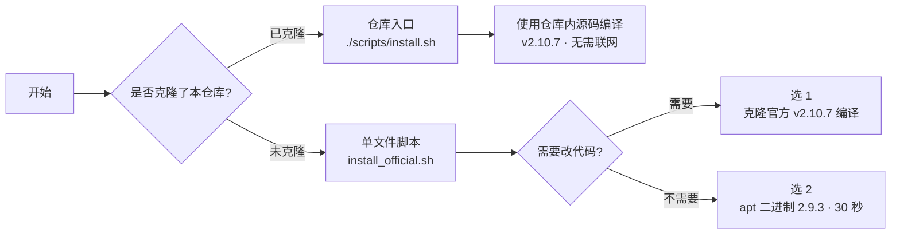

# Orbbec 相机 ROS 2 一键安装


在 **Ubuntu 22.04 + ROS 2 Humble** 上一键安装奥比中光（Orbbec）深度相机的 ROS 2 SDK [`OrbbecSDK_ROS2`](https://github.com/orbbec/OrbbecSDK_ROS2)。

- **零参数、全交互**：不需要记任何命令行参数，回车即推荐配置
- **双路线严格隔离**：克隆了仓库走仓库源码编译；没克隆则只需一个脚本文件
- **安装前可预览**：先看脚本要做什么，再决定是否执行
- **装完即用**：进度条可视化、自动写 `~/.bashrc`、自动安装 udev 规则、自动校验设备枚举

安装根目录统一为 `~/ws_orbbec`。本页只做概览，细节都在 `docs/` 里。

---

## 一、选择你的路线



| | 路线 ① 仓库入口 | 路线 ② 单文件脚本 |
|---|---|---|
| **前提** | 已克隆本仓库 | 只下载 `install_official.sh` |
| **安装方式** | 仅源码编译 | 选 `1` 源码编译 / 选 `2` apt 二进制 |
| **版本** | v2.10.7（仓库内源码） | 源码 v2.10.7（可选最新 tag）/ apt 2.9.3 |
| **编译是否需联网** | 否（源码已在仓库内） | 是（需克隆官方仓库） |
| **能否改代码** | 能 | 源码能，apt 不能 |
| **详细文档** | [02 仓库源码](docs/02-方式A-开箱即用.md) | [03 单文件脚本](docs/03-方式B-官方方式.md) |

**路线隔离规则（强制）**

- 克隆了本仓库 → 只用 `./scripts/install.sh`，脚本**不会**调用 `git clone` 官方仓库，也**不提供官方克隆或 apt 作为保底**；仓库源码缺失时直接报错，请重新克隆本仓库。
- 没克隆本仓库 → 只用 `install_official.sh`，放在任意目录运行即可；脚本检测到自己位于本仓库内时会直接退出，提示改用仓库入口。
- apt 选项仅存在于单文件入口（仓库入口装 apt 会让仓库源码闲置，故已移除）。

> 源码与二进制不要混装；切换时先卸载或重新 `source` 环境。

---

## 二、快速开始

**路线 ①**（已克隆本仓库）：

```bash
cd ~/ws_orbbec
./scripts/install.sh
```

回车即源码编译；选 `2` 为预览模式，只打印将执行的命令。

**路线 ②**（未克隆本仓库）：只下载一个脚本，以下任选其一（不要克隆本仓库）：

```bash
# 方式 a：从 Release 下载（推荐，版本固定，与 tag 对应）
curl -fsSLO https://github.com/YogurtOrange/ws_orbbec/releases/latest/download/install_official.sh

# 方式 b：从 Release 指定版本下载
curl -fsSLO https://github.com/YogurtOrange/ws_orbbec/releases/download/sdk-v2.10.7/install_official.sh

# 方式 c：从仓库 main 分支直连下载（始终最新）
curl -fsSLO https://raw.githubusercontent.com/YogurtOrange/ws_orbbec/main/install_official.sh
```

> 方式 a/b 依赖仓库的 Releases 页面存在对应附件（见下方"发布脚本到 Release"）；方式 c 不依赖 Release，随 main 分支实时更新。

然后在脚本所在目录运行：

```bash
bash install_official.sh
```

**安装完成后**：

```bash
source ~/ws_orbbec/install/setup.bash        # 源码方式
ros2 launch orbbec_camera gemini2.launch.py
```

安装结束时会询问是否写入 `~/.bashrc`（默认写入，带 `# >>> orbbec_camera` 标记块，重复运行只更新不追加），新开终端自动加载。apt 方式对应 `source /opt/ros/humble/setup.bash`。

启动、话题验证与各机型 launch 文件见 [04 启动与验证](docs/04-启动与验证.md)。

### 发布脚本到 Release（维护者操作）

脚本更新后，把新版 `install_official.sh` 挂到 Release，让路线 ② 的方式 a/b 始终可用：

1. 打开仓库 [Releases](https://github.com/YogurtOrange/ws_orbbec/releases) → "Draft a new release"
2. 选择已有 tag（如 `sdk-v2.10.7`）或新建 tag
3. 填写标题与说明（注明适配的 `OrbbecSDK_ROS2` 版本）
4. 在 "Attach binaries" 处拖入 `install_official.sh`，点击 "Publish release"

发布后 `releases/latest/download/install_official.sh` 会自动指向最新一次发布的附件。

---

## 三、文档导航

| 文档 | 内容 |
|---|---|
| [01 环境准备](docs/01-环境准备.md) | 系统/ROS 2 版本校验、apt 源、工作空间命名约定 |
| [02 仓库源码：开箱即用](docs/02-方式A-开箱即用.md) | 仓库入口一键安装、分步执行说明 |
| [03 单文件脚本：官方方式](docs/03-方式B-官方方式.md) | 单文件脚本两选项的区别、官方手动步骤、版本策略 |
| [04 启动与验证](docs/04-启动与验证.md) | 加载环境、枚举设备、机型 launch 映射、apt 差异 |
| [05 常见问题](docs/05-常见问题.md) | 权限、设备未枚举、编译报错、混装排查 |

---

## 四、目录结构

```text
ws_orbbec/
├── README.md                  # 本文件：概览与路线选择
├── install_official.sh        # 单文件入口（未克隆仓库者使用）
├── docs/                      # 分步教程（01 ~ 05）
├── scripts/
│   ├── install.sh             # 仓库入口：源码编译 / 预览
│   ├── check_env.sh           # 环境自检（系统/ROS/架构/工具链/USB）
│   ├── install_deps.sh        # apt 依赖安装（官方清单 33 项）
│   ├── build_ws.sh            # colcon build（Release + symlink）
│   ├── install_udev.sh        # udev 规则安装（需 sudo）
│   ├── verify.sh              # 设备枚举 + 启动冒烟测试
│   └── uninstall.sh           # 清理构建产物 / udev / 源码
└── src/OrbbecSDK_ROS2/        # 仓库内源码（v2.10.7）
```

---

## 五、前置要求

| 项目 | 要求 |
|---|---|
| 操作系统 | Ubuntu 22.04（amd64 / arm64，脚本自动检测） |
| ROS 2 | Humble（`/opt/ros/humble/setup.bash` 存在） |
| 权限 | 可用 `sudo` 安装依赖与 udev 规则 |
| 硬件 | 相机经 **USB 3.0** 直连（USB 2.0 会降分辨率/帧率甚至无法启动） |

首次使用建议先过一遍 [01 环境准备](docs/01-环境准备.md)。

---

## 六、版本说明

- 锁定 `OrbbecSDK_ROS2` **v2.10.7**（官方最新 tag），仓库内源码与官方完全一致，未做本地修改
- SDK 动态库随源码提供：`orbbec_camera/SDK/{x64,arm64}/lib/libOrbbecSDK.so.2.10.6`，编译时 CMake 按架构自动选择
- 单文件入口源码方式可选：固定版本 v2.10.7（已验证可用，推荐）/ 自动获取官方最新 tag（未经本教程验证）

---

## 声明与源码归属

- `src/OrbbecSDK_ROS2` 源码版权归 [orbbec/OrbbecSDK_ROS2](https://github.com/orbbec/OrbbecSDK_ROS2) 官方所有（Apache-2.0 协议）。
- 本仓库所有者（YogurtOrange）**仅**为便于初学者开箱即用、克隆后无需联网即可编译，将官方**固定版本 v2.10.7** 的源码原样归入本仓库的 `src/OrbbecSDK_ROS2/`，未做任何修改。
- 归入的源码不会随官方更新而更新，也不由本仓库所有者维护；需要新版本请以官方仓库为准。
- 本仓库原创部分（`scripts/` 安装脚本、`docs/` 教程、`install_official.sh`）归本仓库所有者所有。
